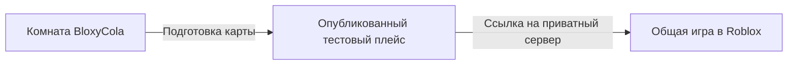

# BloxyCola Create

Совместное редактирование карт и скриптов в Roblox Studio через свой сервер.

[Скачать тестовую сборку](https://github.com/byrilo/BloxyCola-Create/releases/download/v0.1.0-beta.1/BloxyCola-Create-v0.1.0-beta.1.zip) · [Что вошло в релиз](https://github.com/byrilo/BloxyCola-Create/releases/tag/v0.1.0-beta.1)

[](https://github.com/byrilo/BloxyCola-Create/actions/workflows/ci.yml)

## Быстрый старт

Для Windows понадобятся Roblox Studio и Python 3.

1. Распакуйте архив. В Roblox Studio откройте **Plugins → Plugins Folder**, скопируйте туда `PlaceTogether.rbxmx` и перезапустите Studio. Разрешите плагину HTTP-запросы и запись скриптов, когда Studio попросит.
2. Запустите сервер из папки архива. Аргумент в примере задаёт пароль комнаты. Замените его своим.

   ```powershell
   .\StartPlaceTogetherServer.bat "my-room-password"
   ```

3. В **Settings** укажите адрес и пароль сервера. Для хоста адрес — `http://127.0.0.1:8787`. Остальные участники используют адрес хоста в общей сети или VPN.
4. На вкладке **Together** нажмите **Start Hosting Current Place** и пригласите участников через **Invite Peer**. Приглашённый открывает пустой Baseplate и принимает приглашение. Чат и курсоры участников доступны в комнате, а резервные копии — в **Saves & Rooms**.

## Плейтест с друзьями

Редактирование идёт через BloxyCola, а игровой тест — через обычный клиент Roblox. У каждого игрока свой Backpack, работают инструменты из `StarterPack` и скрипты плейса. Вместимость задаётся в настройках плейса. Для входа в игру участникам достаточно доступа к приватному серверу.



1. Настройте отдельный тестовый experience. Roblox требует публичный experience для включения приватных серверов. Сам приватный сервер можно открыть только приглашённым. [Настройка приватных серверов](https://create.roblox.com/docs/production/monetization/private-servers)
2. Нажмите **Sync place before publishing** и опубликуйте актуальную копию в тестовый плейс. Если приватный сервер запущен на старой версии, перезапустите его.
3. Вставьте ссылку приватного сервера в **Playtest with friends** и нажмите **Share playtest invite**. Участники скопируют ссылку из комнаты и откроют её в браузере.

Для быстрой прогулки по карте в режиме редактирования есть **Movement preview**.

## Отмена своих правок

**Undo my change** отменяет последнюю группу правок, принятую сервером, и сохраняет более свежие изменения напарника. История хранит до 24 групп за текущее подключение. Правки ландшафта в эту историю не входят.

Чтобы использовать **Ctrl+Z**, откройте **File → Customize Shortcuts** и назначьте сочетание команде **BloxyCola: Undo my change**. Если оно занято штатным **Undo**, переназначьте его в том же окне. Подсказка также есть в панели плагина.

## Звук запуска

Установите звук перед запуском Studio. После обновления Studio повторите команду.

```powershell
powershell -ExecutionPolicy Bypass -File .\InstallStartupSound.ps1
```

## Сборка и тесты

Исходник плагина находится в [plugin_source.luau](plugin_source.luau), сервер — в [server.py](server.py), тесты — в [tests/](tests/).

```powershell
python build.py
python -m unittest discover -s tests
```

Основа проекта — [Place Together Remake](https://github.com/NeDollManB/Place-Together-Remake).
