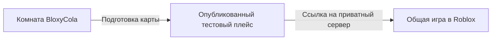

# BloxyCola Create

**Своя комната для совместной работы в Roblox Studio.** Редактируйте карту и скрипты через собственный сервер, затем приглашайте команду на плейтест.

[Скачать v0.1.2 для Windows](https://github.com/byrilo/BloxyCola-Create/releases/download/v0.1.2/BloxyCola-Create-v0.1.2-windows.zip) · [Релизы](https://github.com/byrilo/BloxyCola-Create/releases) · [Сообщить об ошибке](https://github.com/byrilo/BloxyCola-Create/issues/new?template=bug.yml)

[](https://github.com/byrilo/BloxyCola-Create/actions/workflows/ci.yml)

[Установка](#быстрый-старт) · [Плейтест](#плейтест-с-друзьями) · [Ctrl+Z](#отмена-своих-правок) · [Подключение](#проверка-подключения)

## Быстрый старт

Для Windows понадобятся Roblox Studio и Python 3.10 или новее.

1. Скачайте ZIP по ссылке выше и распакуйте его. Дважды нажмите `InstallBloxyCola.bat`. Откройте или перезапустите Roblox Studio. Разрешите плагину HTTP-запросы и запись скриптов, когда Studio попросит.
2. Запустите сервер из папки архива. Аргумент в примере задаёт пароль комнаты. Замените его своим.

   ```powershell
   .\StartPlaceTogetherServer.bat "my-room-password"
   ```

3. В **Settings** укажите адрес и пароль сервера. Для хоста адрес — `http://127.0.0.1:8787`. Остальные участники используют адрес хоста в общей сети или VPN.
4. На вкладке **Together** нажмите **Start Hosting Current Place** и пригласите участников через **Invite Peer**. Приглашённый открывает пустой Baseplate и принимает приглашение. Вместо приглашения по нику можно скопировать **Room code** у хоста. Напарник вставляет его в **Join by room code**. Чат и курсоры доступны в комнате, резервные копии — в **Saves & Rooms**.

При входе плагин показывает этап загрузки и счётчик обработанных объектов. Если часть карты не удалось применить, число проблемных объектов останется в панели комнаты, а подробности появятся в **Output**.

## Плейтест с друзьями

Редактирование идёт через BloxyCola, а игровой тест — через обычный клиент Roblox. У каждого игрока свой Backpack, работают инструменты из `StarterPack` и скрипты плейса. Вместимость задаётся в настройках плейса. Для входа в игру участникам достаточно доступа к приватному серверу.



1. Настройте отдельный тестовый experience. Roblox требует публичный experience для включения приватных серверов. Сам приватный сервер можно открыть только приглашённым. [Настройка приватных серверов](https://create.roblox.com/docs/production/monetization/private-servers)
2. Нажмите **Sync place before publishing** и опубликуйте актуальную копию в тестовый плейс. Если приватный сервер запущен на старой версии, перезапустите его.
3. Вставьте ссылку приватного сервера в **Playtest with friends** и нажмите **Share playtest invite**. Участники скопируют ссылку из комнаты и откроют её в браузере.

Для быстрой прогулки по карте в режиме редактирования есть **Movement preview**.

## Отмена своих правок

**Undo my change** отменяет последнюю группу правок, принятую сервером из этого окна Studio, и сохраняет более свежие изменения напарника. Несколько быстрых действий могут попасть в одну группу. Если синхронизация уже идёт, кнопка дождётся её завершения. История хранит до 24 групп за текущее подключение. Правки ландшафта в эту историю не входят.

Чтобы использовать **Ctrl+Z**, откройте **File → Customize Shortcuts** и назначьте сочетание команде **BloxyCola: Undo my change**. Если оно занято штатным **Undo**, переназначьте его в том же окне. Подсказка также есть в панели плагина.

## Проверка подключения

В **Settings → Check server connection** можно проверить адрес, пароль и время ответа сервера. В комнате отображаются время с последней синхронизации, длительность HTTP-запроса и количество изменений из последней группы, ожидающих отправки.

## Звук запуска

При открытии панели проигрывается звук открытия банки. Установщик для Windows добавляет его вместе с плагином, поэтому для воспроизведения не нужен доступ к серверам Roblox. После обновления Studio запустите установщик повторно, если звук пропал. Запись morgantj, [Freesound](https://freesound.org/people/morgantj/sounds/58846/), [CC BY 4.0](https://creativecommons.org/licenses/by/4.0/).

## Сборка и тесты

Исходник плагина находится в [plugin_source.luau](plugin_source.luau), сервер — в [server.py](server.py), тесты — в [tests/](tests/).

```powershell
python build.py
python -m unittest discover -s tests
```

После успешного CI для `main` и тегов `v*` Windows-архив доступен в **Artifacts** на странице запуска. [GitHub Actions](https://github.com/byrilo/BloxyCola-Create/actions/workflows/ci.yml)

Основа проекта — [Place Together Remake](https://github.com/NeDollManB/Place-Together-Remake).
