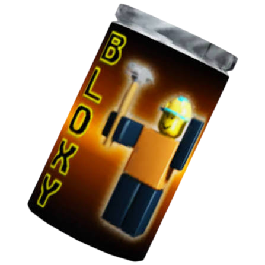

# BloxyCola Create

Плагин для совместной работы в Roblox Studio. Участники подключаются к одной комнате и редактируют карту и скрипты. Есть приглашения, курсоры участников, чат и резервные копии комнат.

## Установка

1. В Roblox Studio откройте **Plugins → Plugins Folder** и скопируйте туда [PlaceTogether.rbxmx](PlaceTogether.rbxmx). Перезапустите Studio и разрешите плагину HTTP-запросы и запись скриптов, когда Studio попросит.
2. Установите Python 3 и запустите [StartPlaceTogetherServer.bat](StartPlaceTogetherServer.bat). Для актуального протокола синхронизации нужен [server.py](server.py).
3. В **Settings** введите адрес сервера. На одном компьютере используйте `http://127.0.0.1:8787`, с других компьютеров укажите адрес хоста в общей сети или VPN.
4. На вкладке **Together** нажмите **Start Hosting Current Place** и пригласите участников. Сохранённые комнаты и резервные копии находятся в **Saves & Rooms**.

Звук запуска на Windows устанавливается командой `powershell -ExecutionPolicy Bypass -File .\InstallStartupSound.ps1` из папки проекта. После обновления Studio запустите её ещё раз.

## Плейтест с друзьями

1. Один раз настройте отдельный тестовый experience: опубликуйте его, включите бесплатные **Private Servers**, создайте сервер и скопируйте его ссылку. Roblox требует публичный experience для включения приватных серверов. Доступ к самому приватному серверу можно ограничить. [Настройка приватных серверов](https://create.roblox.com/docs/production/monetization/private-servers)
2. В комнате BloxyCola нажмите **Sync place before publishing** и опубликуйте актуальную копию в тестовый плейс. Если на сервере ещё открыта предыдущая версия, перезапустите игровой сервер через Roblox.
3. Вставьте ссылку приватного сервера в **Playtest with friends** и нажмите **Share playtest invite**. Участники комнаты копируют ссылку и открывают её в браузере. Roblox запустит игру на одном приватном сервере. Team Create и доступ на редактирование участникам не нужны.
4. Всем нужен доступ к обычному клиенту Roblox и к приватному серверу. Число игроков ограничено вместимостью плейса в Roblox. У каждого игрока свой Backpack, а инструменты из `StarterPack` и скрипты плейса работают как в обычной игре.

**Movement preview** остаётся доступен для прогулки по карте в режиме редактирования.

## Отмена и синхронизация

**Undo my change** отменяет последнюю группу твоих изменений, принятую сервером. Если другой участник изменил то же свойство, плагин сохраняет его версию. Можно отменить до 24 групп за текущее подключение. Для этой команды нужен актуальный `server.py`. Изменения ландшафта в эту историю не входят.

Чтобы назначить Ctrl+Z, нажми **How to set Ctrl+Z**. В Studio открой **File → Customize Shortcuts** и назначь сочетание команде **BloxyCola: Undo my change**. Если оно занято штатным **Undo**, переназначь его в том же окне.

Исходный проект — [Place Together Remake](https://github.com/NeDollManB/Place-Together-Remake). После изменения `plugin_source.luau` пересоберите плагин командой `python build.py`.
